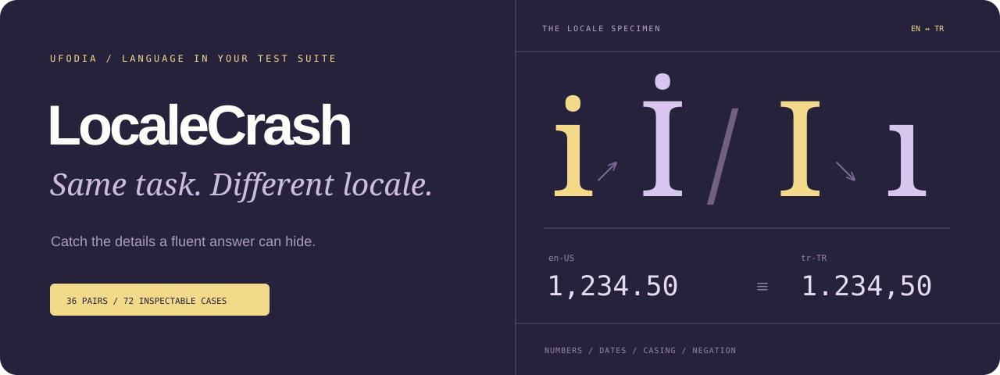
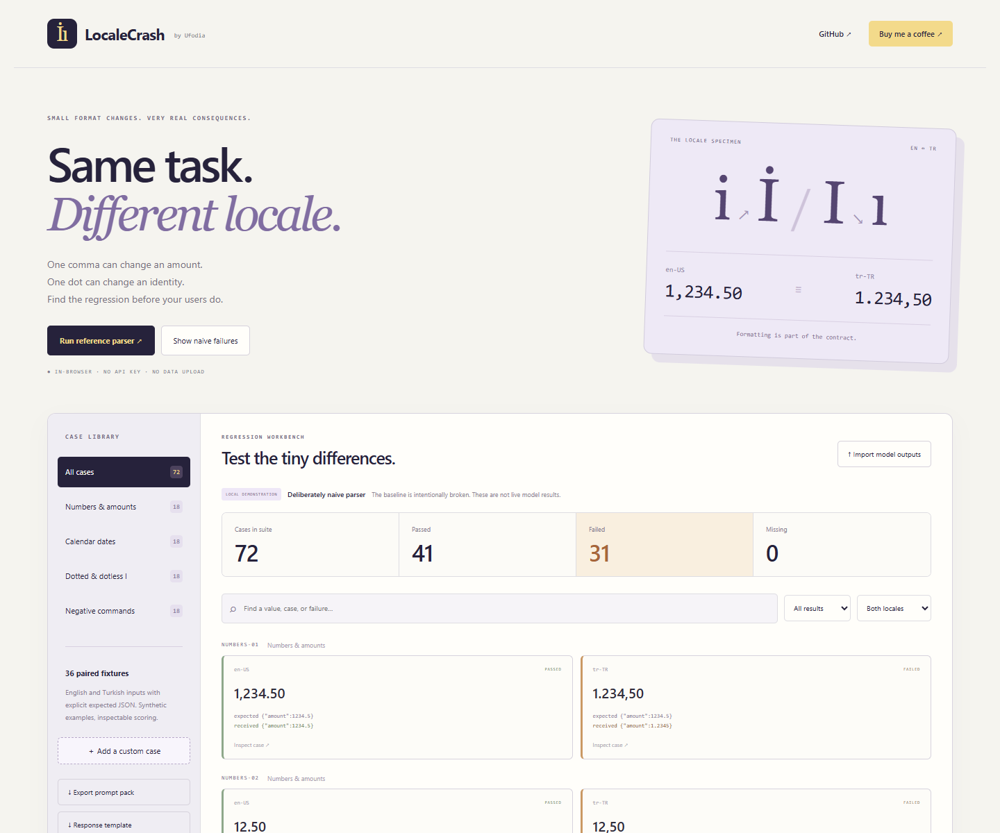

<p align="center"></p>

<p align="center"><strong>A locale regression workbench for structured AI outputs.</strong><br>Catch the comma, calendar, dotted-I, and negative-command mistakes that hide inside a fluent response.</p>
<p align="center"><a href="LICENSE">MIT · Ufodia</a> &nbsp; / &nbsp; 36 pairs · 72 cases &nbsp; / &nbsp; Local scoring &nbsp; / &nbsp; No API key</p>
<p align="center"><a href="https://buymeacoffee.com/ufodia"></a></p>


**[Open the live app ↗](https://locale-crash.vercel.app/)** · [Deployment guide](docs/DEPLOYMENT.md)

## One small change. A different result.

`1,234.50` and `1.234,50` can mean the same amount. `I` lowercases to `i` in English and `ı` in Turkish. A Turkish negative command can hide its negation inside the verb.

LocaleCrash gives those details an explicit test contract. Inspect the prompt, expected JSON, actual output, and field-level differences. Run the included parsers to understand the failure, or bring responses from your own model or agent harness.



## Quick start

Install **Node.js 24 LTS** and npm:

```sh
git clone https://github.com/ufodia/locale-crash.git
cd locale-crash
npm ci
npm run dev
```

Open the local URL printed by Vite. The initial view is a **deliberately naive local parser**, clearly labeled as a demonstration. Click **Run reference parser** to compare with a locale-aware finite parser. Neither parser is an LLM, and no remote model is contacted.

## What is in the library?

| Category | Pairs | Example | Expected behavior |
| --- | ---: | --- | --- |
| Numbers and amounts | 9 | `1,234.50` ↔ `1.234,50` | Preserve the numeric amount |
| Calendar dates | 9 | `04/05/2026` ↔ `05.04.2026` | Use the declared locale, return `2026-04-05` |
| Dotted and dotless I | 9 | `I` lowercased in `en-US` and `tr-TR` | Return `i` and `ı` respectively |
| Negative commands | 9 | `Do not send the invoice.` ↔ `Faturayı gönderme.` | Preserve `allowed: false` |

The fixtures are small, synthetic, and inspectable in [src/fixtures.ts](src/fixtures.ts). They exercise particular failure modes; they do not establish a general model ranking or language capability score.

## Score your own model outputs

1. Click **Export prompt pack**. It contains case IDs, prompts, locales, and required output field types. Expected answers are omitted.
2. Run those prompts through your own model or agent harness.
3. Fill a [response file](docs/formats.md), using the original case IDs and parsed JSON outputs.
4. Click **Import model outputs** or run the CLI.
5. Inspect failures and export a JSON or CSV report. Unanswered cases remain **missing**, not passed or failed.

```json
{
  "format": "locale-crash/responses/1",
  "label": "My agent run",
  "responses": [
    { "caseId": "numbers-01-en", "output": { "amount": 1234.5 } },
    { "caseId": "numbers-01-tr", "output": { "amount": 1.234 } }
  ]
}
```

```sh
npm run score -- examples/responses.json
npm run score -- examples/responses.json --csv
npm run score -- --reference
npm run fixtures -- --out prompts.json
```

CLI exit codes: `0` means all supplied-suite cases pass; `2` means at least one failure or missing response; `1` means invalid input or an operational error. The example response file intentionally contains one failure and 70 missing answers, so its exit code is `2`. Output files use exclusive creation and never silently overwrite an existing file.

## Designed for inspection

- Filter by category, locale, result status, or input text.
- Open any case to see its prompt, expected object, actual response, and exact field mismatches.
- Check a manually entered JSON response for one case.
- Add custom regression cases with your own expected scalar fields.
- Export prompts without expected answers, response templates, and reports.
- Run the pure scoring engine and CLI in your own local workflow.

All interface and documentation text is English. Turkish text appears intentionally inside test inputs and prompts.

## Privacy, scoring, and limitations

Inputs stay in browser memory. There is no analytics, remote font, account connection, automatic model call, or data upload. Refresh clears the current session; export your custom work before closing. Support and source links navigate externally only when selected.

Scoring is strict JSON equality: value types matter, key order does not, and extra fields fail. The reference parser handles documented numeric/date formats and a small command grammar; it is not a general translator or reasoning model. [Read the limitations](docs/limitations.md) before interpreting a result.

## Develop and verify

```sh
npm run typecheck
npm test
npm run build
npm run preview
```

The test suite checks every built-in expected result, invalid dates and numbers, negative commands, duplicate and unknown response IDs, missing answers, extra fields, custom validation, and CSV escaping. Checks-only GitHub Actions runs on `main` and pull requests; it does not deploy.

## Documentation

| Guide | Purpose |
| --- | --- |
| [User guide](docs/user-guide.md) | Inspect a failure and score your own output |
| [Formats](docs/formats.md) | Prompt packs, responses, reports, custom cases |
| [Architecture](docs/architecture.md) | Parser contracts, scoring API, restore/setup |
| [Limitations](docs/limitations.md) | What this suite can and cannot tell you |
| [Contributing](CONTRIBUTING.md) | Add a focused regression or improvement |
| [Security](SECURITY.md) | Report vulnerabilities privately |
| [Changelog](CHANGELOG.md) | Version history |

## Help keep the details right

If LocaleCrash helped you catch a locale bug, [buy Ufodia a coffee](https://buymeacoffee.com/ufodia). Support helps maintain fixtures, examples, and adapters. A small reproducible case or corrected explanation is also a valuable contribution.

Licensed under the [MIT License](LICENSE). Copyright © 2026 **Ufodia**.

## Browser checks

The real workbench flow is covered by [Playwright browser tests](docs/BROWSER_TESTS.md), including local exports and mobile layout. Run `npm run test:browser` after installing Chromium.
